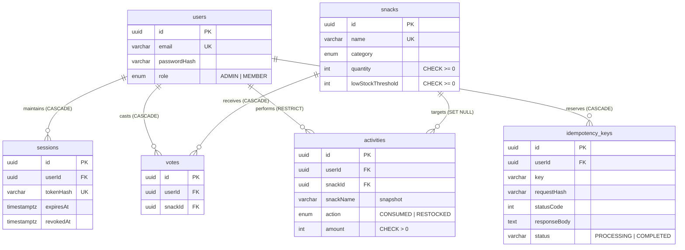
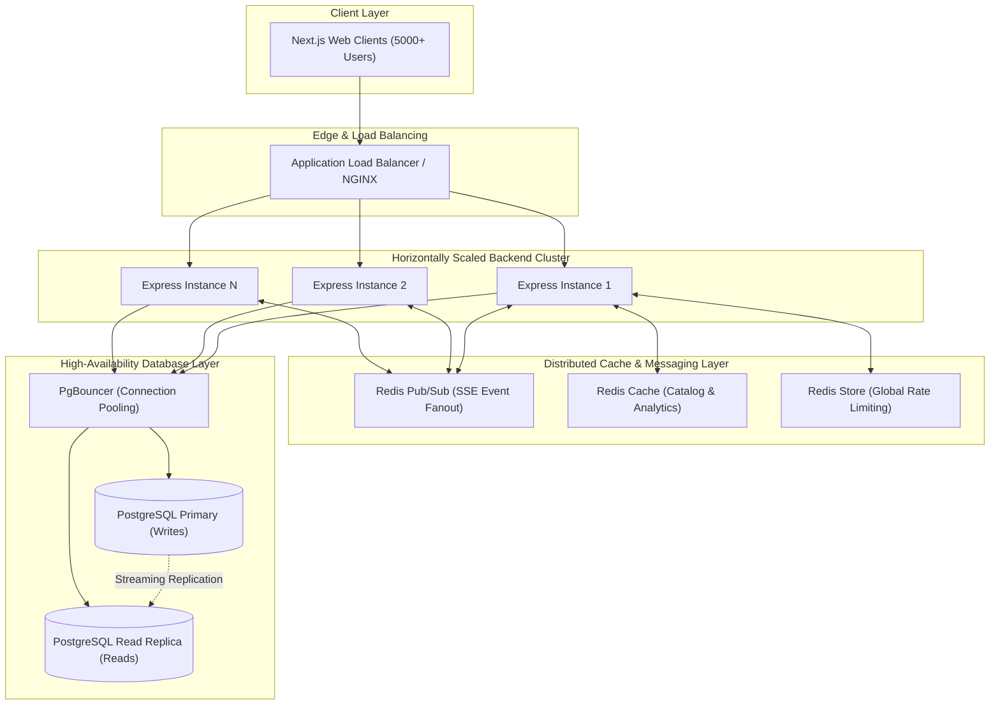

# Snack Overflow — Office Pantry & Snack Inventory System


**Snack Overflow** is a full-stack, production-engineered office pantry and snack inventory management application built to handle high-concurrency snack consumption without race conditions, stock discrepancies, or duplicate voting.

> [!NOTE]
> **Live Production Deployment**:
> - **Web Application (Frontend)**: [https://frontend-production-9a459a36.up.railway.app](https://frontend-production-9a459a36.up.railway.app)
> - **REST API (Backend)**: [https://backend-production-7c00151e.up.railway.app](https://backend-production-7c00151e.up.railway.app)
> - **GitHub Repository**: [https://github.com/SanjayKumarHM13/snack_overflow](https://github.com/SanjayKumarHM13/snack_overflow)

---

## Table of Contents

1. [Key Features](#key-features)
2. [Live Demo & Demo Credentials](#live-demo--demo-credentials)
3. [Technology Stack](#technology-stack)
4. [Project Structure](#project-structure)
5. [Getting Started & Local Setup](#getting-started--local-setup)
6. [REST API Endpoints Summary](#rest-api-endpoints-summary)
7. [Database Schema & Data Integrity](#database-schema--data-integrity)
8. [Authentication, Authorization & Security](#authentication-authorization--security)
9. [Concurrency Guarantees & Race-Condition Prevention](#concurrency-guarantees--race-condition-prevention)
10. [Design Decisions, Technical Trade-offs & Scalability](#design-decisions-technical-trade-offs--scalability)
    - [A. Key Design Decisions](#a-key-design-decisions)
    - [B. Technical Trade-offs](#b-technical-trade-offs)
    - [C. What Would Break First at 100x the Users?](#c-what-would-break-first-at-100x-the-users)
    - [D. Proposed Scaling Strategy (Future Architecture Roadmap)](#d-proposed-scaling-strategy-future-architecture-roadmap)
11. [Automated Testing & Concurrency Verification](#automated-testing--concurrency-verification)
12. [Documentation Index](#documentation-index)

---

## Key Features

- **Race-Condition-Free Inventory Consumption:** Employs atomic conditional PostgreSQL `UPDATE` statements with row-level locks ensuring that even if 10 users click "Consume" simultaneously on the last 3 items, exactly 3 succeed and 7 receive `409 Conflict`.
- **Idempotency-Key Protection:** Supports `Idempotency-Key` headers on single-item and basket consumption endpoints to guarantee network retry safety, double-click prevention, and deterministic replay responses (`Idempotency-Replayed: true`).
- **Real-Time Inventory & Voting Updates:** Authenticated Server-Sent Events (SSE) connection (`GET /api/events`) delivers instant UI synchronization across all open sessions for stock changes, basket operations, catalog edits, and votes without full-page reloads.
- **Self-Service Member Sign-up:** Dedicated registration portal (`/auth/register`) with interactive password strength indicators, bcrypt cost 12 hashing, server-enforced `MEMBER` role, rate limiting (5 attempts / 15 min), and feature toggle (`ENABLE_MEMBER_REGISTRATION`).
- **Multi-Snack Transactional Basket:** Members can assemble multiple snack varieties and quantities into a snack basket, atomically consumed in an all-or-nothing PostgreSQL transaction (`POST /api/snacks/consume-basket`).
- **Strict Role-Based Experience (RBAC):**
  - **Admin:** Insight-driven dashboard (`/dashboard`), full inventory management (`/admin`), and immutable audit trail (`/activities`). Consumption controls are completely removed from both UI and API (`403 MEMBER_ROLE_REQUIRED`).
  - **Member:** Primary landing on the Snack Catalog (`/snacks`), personalized **My Favourites** (`/favourites`), and personal **Consumption History** (`/history`).
- **Global Theme Engine:** Seamless switching between **Light** (`#F8F7F3`), **Dark** (`#0B1120`), and **System** preference with zero page flicker, persistent storage, and WCAG AAA contrast.
- **Hardened Database Integrity:** Enforces composite unique constraints on `(userId, snackId)`, `CHECK (quantity >= 0)`, `CHECK (lowStockThreshold >= 0)`, and `CHECK (amount > 0)`.
- **Dynamic Stock Status:** Real-time computation of `STOCKED`, `RUNNING_LOW`, and `GONE` statuses—never stored statically in the database.
- **Audit-Trail Continuity:** Uses `ON DELETE RESTRICT` for users to guarantee immutable activity history, and `ON DELETE SET NULL` with a historical snack snapshot for deleted items.
- **Dual-Layer CSRF Defense:** Origin and Referer verification coupled with cryptographic synchronizer tokens (`snack_csrf` cookie + `X-CSRF-Token` header) and server-side session revocation.
- **Modern Pantry Dashboard:** Live telemetry, Snack of the Week calculation with deterministic tie-breaking, real-time alerts, and recent activities.

---

## Live Demo & Demo Credentials

The application is deployed on Railway with live PostgreSQL persistence. You can test both roles using the pre-seeded credentials:

| Role | Email | Password | Access & Permissions |
| :--- | :--- | :--- | :--- |
| **Admin** | `admin@example.com` | `Admin1234!` | Full inventory CRUD, restocking, global activity audit trail, analytics dashboard |
| **Member** | `member@example.com` | `Member1234!` | View catalog, single/basket snack consumption, voting/favourites, personal history |

> [!TIP]
> Open two different browser windows (e.g., normal and incognito) with Admin and Member logged in simultaneously to observe live Server-Sent Events (SSE) instant catalog synchronization when snacks are restocked or consumed.

---

## Technology Stack

| Layer | Technologies & Tools | Purpose |
| :--- | :--- | :--- |
| **Frontend** | Next.js 15 (App Router), React 19, TypeScript, Tailwind CSS, TanStack Query, React Hook Form, Zod, Lucide React | Type-safe, responsive user interface with optimistic caching and live SSE synchronization |
| **Backend** | Node.js 22 LTS, Express.js 4.21, TypeScript 5.7, Prisma ORM 6.4, Zod, bcryptjs, Cookie-Parser | Layered REST API enforcing business invariants, atomic SQL decrements, and session management |
| **Database** | PostgreSQL 18 with relational integrity & check constraints | ACID persistence, row-level locking, composite uniqueness, and audit continuity |
| **Testing** | Vitest, Supertest, real PostgreSQL concurrency harness | End-to-end integration, high-concurrency race condition testing, and UI unit verification |
| **Hosting** | Railway (Frontend Web, Backend Web Service, Persistent PostgreSQL) | Production deployment with automated CI/CD and secure private networking |

---

## Project Structure

```
snack-overflow/
├── frontend/             # Next.js 15 App Router web client
│   ├── src/
│   │   ├── app/          # Routes: login, register, dashboard, snacks, favourites, history, admin, activities
│   │   ├── components/   # UI components, layout shell, basket drawer, modals, cards
│   │   ├── context/      # AuthContext, BasketContext, ThemeContext, ToastContext, QueryProvider
│   │   ├── hooks/        # useRealtimeEvents (SSE live sync)
│   │   ├── services/     # Centralized API service modules (snack, activity, auth, api)
│   │   └── lib/          # Utilities, dynamic status calculations
│   ├── tests/            # Frontend service and basket state tests (Vitest)
│   └── package.json
├── backend/              # Express.js REST API
│   ├── src/
│   │   ├── config/       # Environment and database configuration
│   │   ├── controllers/  # Request handlers and response envelopes (auth, snack, activity, events)
│   │   ├── middleware/   # Authentication, RBAC, error handling, CSRF, rate-limit
│   │   ├── routes/       # API routes (auth, snack, activity, events)
│   │   ├── services/     # Business logic, idempotency, SSE broker, atomic transactions
│   │   ├── utils/        # Status calculations, error classes
│   │   └── validators/   # Zod request validators
│   ├── prisma/           # Schema, versioned migrations (including idempotency_keys), idempotent seed
│   ├── tests/            # Supertest API, idempotency, SSE & PostgreSQL concurrency tests
│   └── package.json
├── docs/                 # Engineering documentation
│   ├── ARCHITECTURE.md   # System architecture, concurrency, idempotency & SSE design
│   ├── DATABASE.md       # ERD, constraints, schema specification (6 tables)
│   ├── API_SPEC.md       # Full REST API & SSE event stream documentation
│   └── DESIGN_SYSTEM.md  # Design tokens, typography, component guidelines
├── .env.example          # Safe template for environment configuration
└── README.md
```

---

## Getting Started & Local Setup

### Prerequisites
- **Node.js**: `v22.x` or higher
- **npm**: `10.x` or higher
- **PostgreSQL**: `v18.x` running on port `5432`

### Setup Instructions

1. **Clone the repository:**
   ```bash
   git clone https://github.com/SanjayKumarHM13/snack_overflow.git
   cd snack_overflow
   ```

2. **Configure environment variables:**
   ```bash
   cp .env.example .env
   ```
   *Verify `DATABASE_URL`, `JWT_SECRET`, and `FRONTEND_URL` in `.env` match your local environment.*

3. **Install dependencies:**
   ```bash
   npm install
   ```

4. **Run database migrations and seed default data:**
   ```bash
   npm --prefix backend run prisma:migrate
   npm --prefix backend run prisma:seed
   ```

5. **Start development servers:**
   ```bash
   # Terminal 1: Backend API (runs on http://localhost:4000)
   npm --prefix backend run dev

   # Terminal 2: Frontend Client (runs on http://localhost:3000)
   npm --prefix frontend run dev
   ```

6. Open [http://localhost:3000](http://localhost:3000) in your browser and sign in using the demo credentials above.

---

## REST API Endpoints Summary

All API responses follow a unified envelope. State-changing requests (`POST`, `PUT`, `PATCH`, `DELETE`) require a valid session cookie and an `X-CSRF-Token` header.

| Method | Endpoint | Access / Role | Description & Idempotency |
| :--- | :--- | :--- | :--- |
| **POST** | `/api/auth/register` | Public | Create new Member account (rate-limited: 5 req/15 min) |
| **POST** | `/api/auth/login` | Public | Authenticate user, issue HTTP-only `snack_session` cookie |
| **POST** | `/api/auth/logout` | Authenticated | Revoke session in database and clear cookie |
| **GET** | `/api/auth/me` | Authenticated | Get current authenticated user profile & permissions |
| **GET** | `/api/auth/csrf-token` | Public / Auth | Obtain synchronizer CSRF token |
| **GET** | `/api/auth/register-status` | Public | Check if public member registration is enabled |
| **GET** | `/api/snacks` | Authenticated | Paginated, filtered, and sorted snack catalog |
| **GET** | `/api/snacks/:id` | Authenticated | Get single snack details and dynamic stock status |
| **POST** | `/api/snacks` | **Admin Only** | Create a new snack item |
| **PATCH** | `/api/snacks/:id` | **Admin Only** | Update snack metadata (name, category, threshold) |
| **DELETE** | `/api/snacks/:id` | **Admin Only** | Soft-delete snack (preserves activity log with `SET NULL`) |
| **POST** | `/api/snacks/:id/consume` | **Member Only** | Atomic conditional stock decrement (supports `Idempotency-Key`) |
| **POST** | `/api/snacks/:id/restock` | **Admin Only** | Add inventory quantity and record audit log |
| **POST** | `/api/snacks/consume-basket` | **Member Only** | Atomically consume multiple snack items in an all-or-nothing transaction |
| **GET** | `/api/snacks/favourites` | **Member Only** | List snacks endorsed by the authenticated member |
| **POST** | `/api/snacks/:id/vote` | **Member Only** | Endorse a snack (enforces composite unique constraint) |
| **DELETE** | `/api/snacks/:id/vote` | **Member Only** | Remove endorsement from a snack |
| **GET** | `/api/snacks/summary` | Authenticated | Dashboard KPIs, Snack of the Week, and low-stock alerts |
| **GET** | `/api/activities` | **Admin Only** | Paginated organization-wide immutable audit trail |
| **GET** | `/api/activities/me` | **Member Only** | Paginated personal consumption history |
| **GET** | `/api/events` | Authenticated | Server-Sent Events (SSE) live notification stream |

> [!NOTE]
> For complete request bodies, query parameters, Zod schemas, error codes, and SSE event schemas, see the complete [API Specification](docs/API_SPEC.md).

---

## Database Schema & Data Integrity

The persistence layer uses **PostgreSQL 18** managed via **Prisma ORM 6.4**. Data integrity is enforced directly inside the database engine:

| Model / Table | Responsibility | Key Integrity Constraints |
| :--- | :--- | :--- |
| `users` | User accounts, credentials, and roles | `UNIQUE(email)`, bcrypt cost 12 password hash, `role` enum (`ADMIN`, `MEMBER`) |
| `sessions` | Stateful authentication tracking | `tokenHash` (SHA-256), `revokedAt` timestamp for server-side revocation, `expiresAt` |
| `snacks` | Office pantry inventory items | `UNIQUE(name)`, `CHECK(quantity >= 0)`, `CHECK(lowStockThreshold >= 0)` |
| `votes` | Member snack endorsements | Composite `UNIQUE(userId, snackId)` preventing duplicate voting, `ON DELETE CASCADE` |
| `activities` | Immutable audit log of all pantry mutations | `CHECK(amount > 0)`, `ON DELETE RESTRICT` on user, `ON DELETE SET NULL` on snack |
| `idempotency_keys` | Exactly-once execution and retry ledger | Composite `UNIQUE(userId, key)`, SHA-256 request fingerprint, cached response body |



- **Dynamic Stock Computation:** Stock status (`STOCKED`, `RUNNING_LOW`, `GONE`) is computed on-the-fly from `quantity` and `lowStockThreshold`—never stored statically, eliminating state drift.
- **Audit-Trail Continuity:** If an admin deletes a snack, existing `activities` records are preserved via `ON DELETE SET NULL`, retaining a historical snapshot string `snackName`. User records with historical activity cannot be deleted (`ON DELETE RESTRICT`).

> [!NOTE]
> For complete entity definitions, migration history, and database indexes, see the [Database Documentation](docs/DATABASE.md).

---

## Authentication, Authorization & Security

1. **Stateful HTTP-Only Sessions with Server-Side Revocation:**
   - On login, a cryptographically secure token is generated and stored as a SHA-256 hash (`tokenHash`) in PostgreSQL.
   - Sent to the browser as an `HttpOnly`, `SameSite=Lax`, `Secure` cookie named `snack_session` (inaccessible to JavaScript, immune to XSS token theft).
   - Upon logout or security incident, the session record is marked with `revokedAt = NOW()`.
   - Every authenticated request verifies that `revokedAt IS NULL AND expiresAt > NOW()`. Unlike stateless JWTs which cannot be revoked before expiration, compromised sessions are invalidated immediately.

2. **Strict Role-Based Access Control (RBAC):**
   - User roles (`ADMIN` and `MEMBER`) are enforced authoritatively on the backend via Express middleware (`authenticate`, `requireAdmin`, `requireMember`).
   - Admins are prohibited from consuming snacks (`403 MEMBER_ROLE_REQUIRED`) to keep administrative audit trails distinct from pantry consumption.
   - Members cannot access management routes or modify inventory (`403 ADMIN_ROLE_REQUIRED`).

3. **Dual-Layer Defense-in-Depth CSRF Protection:**
   - **Layer 1 (Origin/Referer Validation):** All mutating requests (`POST`, `PUT`, `PATCH`, `DELETE`) are checked against the configured `FRONTEND_URL`. Requests with mismatched or suspicious cross-origin headers are rejected immediately.
   - **Layer 2 (Cryptographic Synchronizer Tokens):** Clients obtain a signed CSRF token from `GET /api/auth/csrf-token` and must supply it via the `X-CSRF-Token` header.

4. **Abuse Prevention & Input Validation:**
   - Dedicated sliding-window rate limiting on `/api/auth/register` (5 attempts per 15 minutes per IP address).
   - All inbound request payloads are parsed and validated against strict Zod schemas before reaching any controller or database logic.

---

## Concurrency Guarantees & Race-Condition Prevention

### The Concurrency Problem: Naive Read-Modify-Write
In naive applications, inventory consumption follows a two-step pattern:
1. `SELECT quantity FROM snacks WHERE id = $1;` (returns 3)
2. `if (quantity >= 1) UPDATE snacks SET quantity = quantity - 1 WHERE id = $1;`

If 10 users click "Consume" concurrently, all 10 read `quantity = 3` before any update writes back. All 10 update statements succeed, leaving the database with `quantity = -7` (physical stock is overconsumed).

### The Solution: Atomic Conditional SQL
Snack Overflow solves this at the database engine level with a single atomic conditional query:
```sql
UPDATE "snacks"
SET "quantity" = "quantity" - $1, "updatedAt" = NOW()
WHERE "id" = $2::uuid AND "quantity" >= $1
RETURNING *;
```
- PostgreSQL serializes conflicting updates using internal row-level locks (`FOR UPDATE`).
- The `WHERE "quantity" >= $1` condition is evaluated atomically at the moment of update execution.
- If 10 requests hit a snack with stock 3:
  - Exactly 3 queries satisfy `quantity >= 1`, decrement stock, and return the modified row.
  - The remaining 7 queries find `quantity = 0`, modify 0 rows, and return an empty set.
  - The service layer detects 0 modified rows and responds with `409 Conflict (INSUFFICIENT_STOCK)`.
- Stock can **never drop below zero**, even under extreme traffic bursts.

### Multi-Item Snack Basket Transactions
When a member consumes a multi-item basket via `POST /api/snacks/consume-basket`:
- All snack decrements are wrapped in a single database transaction (`prisma.$transaction`).
- Each item executes the atomic conditional check.
- **All-or-Nothing Guarantee:** If even one item has insufficient stock, the entire transaction rolls back cleanly, returning `409 Conflict` with itemized error context. Zero partial deductions occur.

### Database-Backed Idempotency Engine
To prevent duplicate deductions caused by double-clicking or network disconnects:
- Clients send a unique UUID header: `Idempotency-Key: <uuid>`.
- The backend computes a deterministic SHA-256 fingerprint of the request payload (`requestHash`).
- The key is reserved in the `idempotency_keys` table with status `PROCESSING`.
- If an exact duplicate request arrives while processing, it waits for completion; if it arrives after completion, the server replays the cached status code and response body with `Idempotency-Replayed: true`.
- If the client changes the payload while reusing the key, the server rejects it with `409 IDEMPOTENCY_KEY_PAYLOAD_MISMATCH`.

---

## Design Decisions, Technical Trade-offs & Scalability

### A. Key Design Decisions

1. **Layered Architecture & Separation of Concerns:**
   The backend is strictly divided into Routes, Validators (Zod), Controllers (HTTP envelopes), Services (business logic & transactions), and Data Access (Prisma & atomic SQL). This prevents business logic leakage into HTTP handlers, guarantees comprehensive testability with Supertest, and allows swapping underlying database mechanisms without touching API routing.

2. **PostgreSQL Transactions & Atomic Conditional Operations:**
   Rather than relying on application-level locks or distributed locking mechanisms, inventory updates leverage PostgreSQL's native MVCC and row-level lock serialization (`UPDATE ... WHERE quantity >= $amount`). This eliminates distributed consensus overhead and ensures zero inventory discrepancies with zero external dependencies.

3. **Database-Backed Idempotency Engine:**
   Network retries and mobile connection drops are common in office pantry apps. By persisting idempotency keys and request fingerprints in PostgreSQL, mutations are guaranteed exactly-once execution semantics across process restarts.

4. **Stateful HTTP-Only Session Cookies with Server-Side Revocation:**
   Stateless JWTs stored in browser `localStorage` are vulnerable to XSS extraction and cannot be revoked before expiration. Snack Overflow stores a cryptographically secure token hash in PostgreSQL, passes it in an `HttpOnly`, `SameSite=Lax`, `Secure` cookie, and validates `revokedAt IS NULL` on every request. This gives administrators immediate kill-switch revocation capabilities.

5. **Server-Sent Events (SSE) for Real-Time Synchronization:**
   Office pantry inventory changes are unidirectional broadcasts (server to clients). SSE (`GET /api/events`) was selected over WebSockets because it operates over standard HTTP/1.1 and HTTP/2, requires no custom connection upgrade handshake, automatically reconnects via browser-native `EventSource`, and passes through corporate proxies and firewalls without connection degradation.

6. **Hardened Database Constraints & Immutable Audit Trail:**
   Business invariants are enforced in the database (`CHECK quantity >= 0`, `CHECK amount > 0`, composite uniqueness on votes and idempotency keys). Deleting users is restricted (`ON DELETE RESTRICT`) to prevent orphaned activity logs, and deleting snacks preserves historical logs via snapshot fields (`ON DELETE SET NULL` with `snackName`), guaranteeing audit compliance.

---

### B. Technical Trade-offs

| Decision | Chosen Approach | Alternative Considered | Trade-off Analysis |
| :--- | :--- | :--- | :--- |
| **Stock Decrements** | Atomic conditional SQL (`UPDATE ... WHERE quantity >= amount`) | Optimistic concurrency control (`version` column) or Redis decrement | **Chosen:** Zero external dependencies; ACID guarantees; zero race conditions.<br>**Trade-off:** High write concurrency on a single row serializes at the database engine level. |
| **Real-Time Transport** | Server-Sent Events (SSE) | WebSockets (Socket.io) | **Chosen:** Lightweight, standard HTTP, native browser auto-reconnect, zero WebSocket upgrade issues.<br>**Trade-off:** Strictly unidirectional; client actions must still be sent via standard REST POST requests. |
| **Event Broker** | In-memory singleton (`SseService` using an in-memory Map of active SSE client response streams) | Distributed message broker (Redis Pub/Sub, RabbitMQ, Kafka) | **Chosen:** Zero operational overhead; sub-millisecond local event dispatch; simple deployment.<br>**Trade-off:** Limited to a single backend process; does not fan out across multiple load-balanced server instances. |
| **Multi-Item Basket** | Single atomic database transaction (`prisma.$transaction`) | Saga pattern / Eventual consistency | **Chosen:** Absolute all-or-nothing consistency; zero partial inventory leakage.<br>**Trade-off:** Holds database row locks across multiple snack rows for the transaction duration. |
| **Session Management** | Database-backed sessions with SHA-256 token hash | Pure stateless JWT in header | **Chosen:** Immediate revocation on logout or compromise; full device/IP auditing.<br>**Trade-off:** Requires a fast database read on every authenticated request (indexed by `tokenHash`). |

---

### C. What Would Break First at 100x the Users?

If concurrent user traffic scaled by 100x (from an office of 50 users to an enterprise campus of 5,000+ simultaneous users):

1. **In-Memory SSE Event Delivery Across Multiple Server Instances:**
   The current real-time notification engine uses an in-memory Map of active SSE client response streams in `SseService`. Under 100x load, the backend would be scaled horizontally into multiple container replicas behind a load balancer. A snack consumption on Replica A would emit an event only to clients connected to Replica A; clients connected to Replica B or C would never receive the live update until manual page reload.

2. **Database Connection Pool Saturation & Throughput Limits:**
   PostgreSQL uses a process-per-connection model. With 100x concurrent users, Prisma's connection pool per instance would quickly exhaust PostgreSQL's `max_connections` limit. New requests would queue waiting for an available database connection, causing HTTP 504 Gateway Timeouts and elevated latency.

3. **Row-Lock Contention on High-Demand Snack Items:**
   If a limited popular snack (e.g., fresh pastries or chocolates) is restocked, hundreds of users may attempt to consume it simultaneously. Because atomic SQL decrements serialize on the exact row lock for that `snackId`, transactions would queue up in PostgreSQL, increasing transaction hold times and potentially triggering lock wait timeouts.

4. **In-Memory Rate Limiting Bypass Across Replicas:**
   The `/api/auth/register` rate limiter currently uses `express-rate-limit` with an in-memory store. Behind a round-robin load balancer across $N$ instances, an attacker could distribute registration attempts, effectively multiplying the allowed threshold by $N$.

5. **Read-Heavy Dashboard Analytics & Activity Query Bottlenecks:**
   The dashboard summary endpoint (`GET /api/snacks/summary`) computes Snack of the Week, category counts, and low-stock alerts on-the-fly. Under 100x traffic, repeated aggregation queries and unindexed deep pagination on the `activities` table would cause heavy disk I/O and CPU spikes on the primary database.

---

### D. Proposed Scaling Strategy (Future Architecture Roadmap)

> [!IMPORTANT]
> The architectural roadmap below details the engineering strategy designed to scale Snack Overflow to 100x user capacity. These improvements represent proposed production evolution steps and are clearly distinguished from the current single-instance deployment.



1. **Distributed Event Bus (Redis Pub/Sub or PostgreSQL `LISTEN`/`NOTIFY`):**
   - Replace the in-memory Map of active SSE client response streams in `SseService` with a Redis Pub/Sub adapter.
   - When any backend instance processes a consumption or restock, it publishes the event to a Redis channel (`events:snack_updates`).
   - Every active backend instance subscribes to the channel and fans out the event to its locally attached SSE client connections, ensuring 100% real-time synchronization across all cluster nodes.

2. **Connection Pooling with PgBouncer:**
   - Deploy **PgBouncer** in transaction pooling mode in front of PostgreSQL.
   - Allows thousands of client connections to share a lightweight pool of 50–100 actual PostgreSQL backend processes, eliminating connection starvation and reducing memory consumption per connection from ~10 MB to under 50 KB.

3. **Read Replicas & CQRS-Lite Separation:**
   - Deploy PostgreSQL read replicas with asynchronous streaming replication.
   - Route read-heavy traffic (`GET /api/snacks`, `GET /api/activities`, `GET /api/snacks/summary`) to read replicas.
   - Reserve the primary PostgreSQL instance exclusively for state-changing write operations (`consume`, `restock`, `vote`, `session creation`).

4. **Distributed Sliding-Window Rate Limiting:**
   - Migrate `express-rate-limit` to use a shared Redis store (`rate-limit-redis`).
   - Implements an atomic sliding-window algorithm that enforces exact IP-based and user-based request limits globally across all running backend containers.

5. **Read-Side Caching with Event-Driven Invalidation:**
   - Cache pre-computed dashboard metrics (`GET /api/snacks/summary`) and popular snack catalog pages in Redis with a 60-second TTL.
   - Use write-through or event-driven cache invalidation: whenever a `SNACK_CONSUMED`, `SNACK_RESTOCKED`, or `VOTE_ADDED` event occurs, evict the corresponding cache key immediately.

6. **Keyset Pagination & Database Index Optimization:**
   - Transition `/api/activities` from `OFFSET/LIMIT` pagination to keyset (cursor-based) pagination using `(createdAt, id)` to prevent high-offset performance degradation.
   - Add composite indexes on `activities(createdAt DESC, userId)` and `snacks(quantity, lowStockThreshold)` to optimize dashboard alert filtering.

7. **Centralized Observability & Telemetry:**
   - Integrate structured JSON logging (via Pino/Winston) with OpenTelemetry distributed tracing.
   - Export Prometheus metrics for database connection pool wait times, HTTP request latency percentiles (p95, p99), and active SSE subscriber counts into Grafana dashboards.

---

## Automated Testing & Concurrency Verification

All integration, concurrency, and idempotency tests run against a real, isolated PostgreSQL test database (`snack_overflow_test`) with zero mock data for database queries.

```bash
# Run all tests across the monorepo (99 tests: 83 backend + 16 frontend)
npm run test

# Run backend integration, idempotency, SSE & concurrency tests only (83 tests across 10 files)
npm run test:backend

# Run frontend service, basket logic & hook tests only (16 tests across 2 files)
npm run test:frontend

# Run strict TypeScript typechecking across the entire monorepo
npm run typecheck

# Run ESLint across monorepo
npm run lint

# Build frontend production bundle
npm --prefix frontend run build
```

### Verified High-Concurrency & Idempotency Scenarios

1. **Scenario 1: 10 Simultaneous Requests against Stock = 3**
   - 10 parallel HTTP POST `/api/snacks/:id/consume` requests with `amount = 1`.
   - **Result:** Exactly 3 requests succeed with `200 OK`, exactly 7 requests receive `409 Conflict (INSUFFICIENT_STOCK)`.
   - **Final Stock:** Exactly `0`. Overconsumption: `0`. Audit records created: exactly `3`.

2. **Scenario 2: Network Replay with Idempotency Key**
   - Client sends `POST /api/snacks/:id/consume` with `Idempotency-Key: <uuid>`. First request succeeds with status 200.
   - Client replays the exact same request due to simulated network timeout.
   - **Result:** Returns cached 200 response with `Idempotency-Replayed: true` header.
   - **Stock:** Decremented exactly once. Duplicate audit records: `0`.
   - Reusing the same key with an altered payload returns `409 IDEMPOTENCY_KEY_PAYLOAD_MISMATCH`.

3. **Scenario 3: Real-Time SSE Synchronization Across Concurrent Sessions**
   - Member B establishes an SSE connection to `/api/events`. Member A consumes a snack with an idempotency key.
   - **Result:** Member B receives a live `SNACK_CONSUMED` event in `< 50ms` without polling. TanStack Query automatically invalidates the cache. Repeated idempotent consumption emits zero extra events.

4. **Scenario 4: Multi-Packet Concurrent Decrement**
   - 2 concurrent requests attempt to consume 2 packets each when stock is 3.
   - **Result:** Exactly 1 request succeeds with `200 OK`, exactly 1 request receives `409 Conflict`.
   - **Final Stock:** Exactly `1`. Audit records created: exactly `1`.

---

## Documentation Index

For in-depth architectural diagrams, database schemas, and API documentation, refer to the dedicated guides in the `docs/` directory:

- 🏛️ [System Architecture & Concurrency Strategy](docs/ARCHITECTURE.md) — Comprehensive architectural patterns, security model, and idempotency flowcharts.
- 🗄️ [Database Architecture & Entity Specifications](docs/DATABASE.md) — Complete ERD, table definitions, constraints, and index optimizations.
- 🔌 [REST API Specification](docs/API_SPEC.md) — Full API reference including request/response examples, error codes, and SSE event contracts.
- 🎨 [Design System & UI Tokens](docs/DESIGN_SYSTEM.md) — Theme tokens, typography, WCAG AAA color palettes, and component hierarchy.
