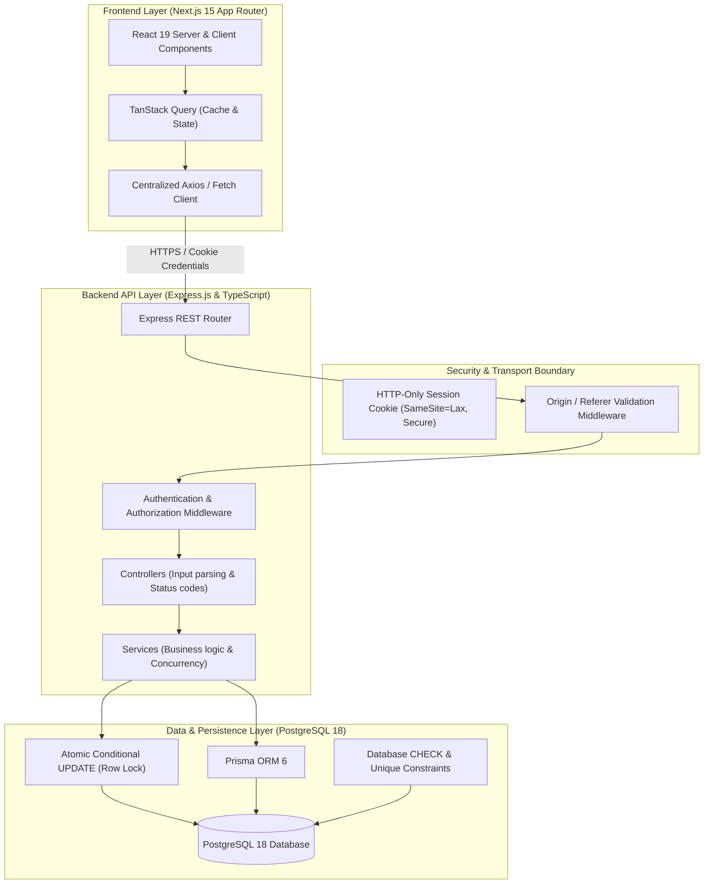

# Snack Overflow — System Architecture

## 1. System Overview
**Snack Overflow** is a high-reliability, production-minded office pantry and snack inventory management SaaS application. It is engineered to solve a common concurrent access problem: maintaining accurate, non-negative pantry inventory under simultaneous multi-user demand.



---

## 2. Architectural Pillars

### A. Strict Decoupling
- The **frontend** (Next.js 15, React 19, Tailwind CSS) is completely decoupled from the backend.
- The **backend** (Express.js, TypeScript, Prisma ORM) is a stateless REST API listening on port 4000.
- All client-to-server communication occurs via authenticated JSON HTTP requests.

### B. Layered Backend Design
1. **Routing (`/src/routes`):** Defines REST resource URIs and binds middleware pipelines.
2. **Validation (`/src/validators`):** Zod schemas strictly validate request bodies, query params, and URL route parameters before reaching controllers.
3. **Controllers (`/src/controllers`):** Handle HTTP transport details (status codes, JSON envelopes), delegating all business logic to services.
4. **Services (`/src/services`):** Encapsulate core domain logic, atomic inventory operations, transactional consistency, and data formatting.
5. **Data Access (`/prisma` & PostgreSQL):** Prisma Client provides type-safe queries, while atomic conditional SQL executes race-free updates directly in the database engine.

---

## 3. Concurrency & Race-Condition Prevention Strategy

### The Flawed Read-Modify-Write Pattern
In naive applications, inventory consumption follows:
1. `SELECT quantity FROM snacks WHERE id = $1;` (returns 3)
2. `if (quantity >= amount) { ... }` (passes in Node.js memory)
3. `UPDATE snacks SET quantity = quantity - amount WHERE id = $1;`

When 10 concurrent requests execute step 1 before any request executes step 3, all 10 see `quantity = 3` and execute decrements, leaving `quantity = -7`.

### The Atomic Conditional Solution
Snack Overflow eliminates race conditions at the database row level:
```sql
UPDATE "snacks"
SET "quantity" = "quantity" - $1, "updatedAt" = NOW()
WHERE "id" = $2::uuid AND "quantity" >= $1
RETURNING *;
```
- PostgreSQL serializes row updates using internal row-level locks (`FOR UPDATE`).
- Only requests where `quantity >= $1` evaluate to true will modify a row and return data.
- Subsequent concurrent requests find `quantity` already reduced. Once stock reaches 0, the `WHERE` condition matches 0 rows.
- When 0 rows are returned, the service disambiguates whether the snack exists (returning `404`) or stock was depleted (returning `409 Conflict`).
- The atomic stock decrement and the creation of the `Activity` log are wrapped in an explicit `prisma.$transaction`.

---

## 4. Authentication & Security Architecture

### A. Server-Side Session & Token Revocation
- Authentication creates a persistent `Session` entity in PostgreSQL with `{ id, userId, token, expiresAt, revokedAt, userAgent, ipAddress }`.
- Transported via an `HttpOnly`, `SameSite=Lax` cookie named `snack_session`.
- **Server-Side Token Revocation:**
  - Upon logout, the session's `revokedAt` timestamp is updated to `NOW()`.
  - The authentication middleware verifies `revokedAt IS NULL AND expiresAt > NOW()` on every request.
  - If a token is compromised, revoking the session invalidates it immediately across all clients, eliminating the vulnerability of stateless JWT expiration delays.

### B. Defense-in-Depth CSRF Protection (Synchronizer Token + Origin Check)
State-changing operations (`POST`, `PUT`, `PATCH`, `DELETE`) are protected by a dual-layer CSRF defense:
1. **Origin & Referer Validation:** Requests must originate from the verified `FRONTEND_URL`.
2. **Synchronizer CSRF Token:**
   - The client fetches a session-bound CSRF token via `GET /api/auth/csrf-token`.
   - State-changing mutations must pass this token in the `X-CSRF-Token` header.
   - The backend validates the header against the active session's expected CSRF secret before dispatching to controllers.
   - Cross-site attackers cannot read or forge this token under browser Same-Origin Policy.

### C. Role-Based Access Control (RBAC)
- Roles: `ADMIN` and `MEMBER`.
- Middleware enforces authorization on every private endpoint:
  - `authenticate`: Validates active, non-revoked session from cookie and attaches user context.
  - `requireAdmin`: Rejects non-admin users with `403 Forbidden`.
- The frontend role indicator is purely presentation-layer; all security is enforced authoritatively on the backend.

---

## 5. Audit Logging & Data Integrity

- **Activity Records:** Every consumption and restocking event creates an immutable audit row.
- **User Integrity (`RESTRICT`):** Deleting a user who has historical activities is restricted by foreign key constraint (`onDelete: Restrict`) to preserve audit trails.
- **Snack Deletion (`SET NULL`):** Deleting a snack preserves the historical activity log by setting `snackId` to `null` while retaining the `snackName` snapshot string.
