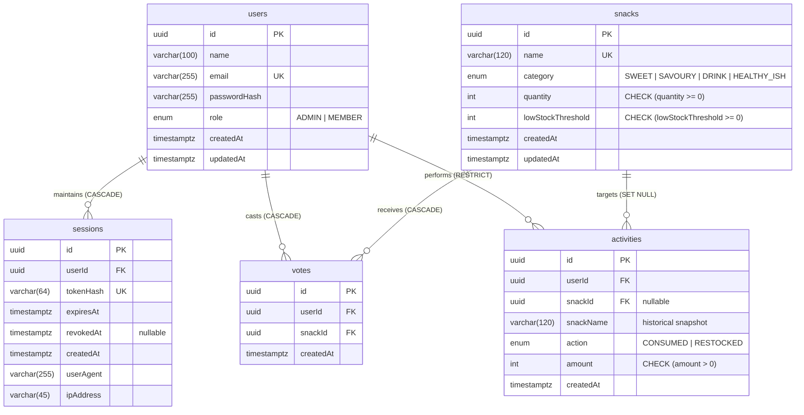

# Snack Overflow — Database Architecture & Specification

## 1. Overview
The persistence layer of Snack Overflow is powered by **PostgreSQL 18** managed via **Prisma ORM**. It enforces relational integrity, check constraints, composite uniqueness, and transactional consistency directly in the database engine.

---

## 2. Entity-Relationship Model

---

## 3. Entities & Attributes

### A. User (`users`)
Represents an employee or administrator.
- `id`: `UUID` primary key.
- `name`: `VARCHAR(100)` — user's display name.
- `email`: `VARCHAR(255)` — unique email address.
- `passwordHash`: `VARCHAR(255)` — bcrypt hashed password (salt cost 12).
- `role`: `Role` enum (`ADMIN` or `MEMBER`).
- `createdAt`, `updatedAt`: `TIMESTAMPTZ(6)`.

### B. Session (`sessions`)
Tracks active and revoked user authentication sessions for server-side revocation.
- `id`: `UUID` primary key.
- `userId`: `UUID` foreign key referencing `users(id)` with `ON DELETE CASCADE`.
- `tokenHash`: `VARCHAR(64)` — unique SHA-256 cryptographic hash of the session raw token.
- `expiresAt`: `TIMESTAMPTZ(6)` — session expiry timestamp.
- `revokedAt`: `TIMESTAMPTZ(6)` — nullable; non-null indicates an invalidated/logged-out session.
- `userAgent`: `VARCHAR(255)` — browser client string.
- `ipAddress`: `VARCHAR(45)` — client IP address.
- `createdAt`: `TIMESTAMPTZ(6)`.

### C. Snack (`snacks`)
Represents an inventory item in the office pantry.
- `id`: `UUID` primary key.
- `name`: `VARCHAR(120)` — unique snack item name.
- `category`: `SnackCategory` enum (`SWEET`, `SAVOURY`, `DRINK`, `HEALTHY_ISH`).
- `quantity`: `INTEGER` — current available packet count (default `0`).
- `lowStockThreshold`: `INTEGER` — threshold for running-low alerts (default `5`).
- `createdAt`, `updatedAt`: `TIMESTAMPTZ(6)`.

### C. Vote (`votes`)
Records an employee's endorsement for a snack.
- `id`: `UUID` primary key.
- `userId`: `UUID` foreign key referencing `users(id)` with `ON DELETE CASCADE`.
- `snackId`: `UUID` foreign key referencing `snacks(id)` with `ON DELETE CASCADE`.
- `createdAt`: `TIMESTAMPTZ(6)`.
- **Constraint:** Composite unique constraint on `(userId, snackId)`. Prevents duplicate voting at the database level.

### D. Activity (`activities`)
Immutable historical audit trail of consumption and restocking operations.
- `id`: `UUID` primary key.
- `userId`: `UUID` foreign key referencing `users(id)` with `ON DELETE RESTRICT`. Ensures user records cannot be deleted if historical activity exists.
- `snackId`: `UUID` nullable foreign key referencing `snacks(id)` with `ON DELETE SET NULL`. If a snack is deleted, the activity row is preserved.
- `snackName`: `VARCHAR(120)` — snapshot of the snack name at the moment the event occurred.
- `action`: `ActivityAction` enum (`CONSUMED` or `RESTOCKED`).
- `amount`: `INTEGER` — positive quantity transferred.
- `createdAt`: `TIMESTAMPTZ(6)`.

### E. Idempotency Key (`idempotency_keys`)
Database-backed ledger for ensuring single and multi-item consumption operations cannot be executed multiple times.
- `id`: `UUID` primary key.
- `key`: `VARCHAR(255)` — client-supplied unique attempt identifier.
- `userId`: `UUID` foreign key referencing `users(id)` with `ON DELETE CASCADE`.
- `operation`: `VARCHAR(100)` — logical operation (e.g., `CONSUME_SNACK`, `CONSUME_BASKET`).
- `requestHash`: `VARCHAR(64)` — deterministic SHA-256 digest of canonical operation + sorted payload.
- `statusCode`: `INTEGER` nullable — captured HTTP response status code upon completion.
- `responseBody`: `TEXT` nullable — cached JSON payload replayed on duplicate requests.
- `status`: `VARCHAR(20)` — state machine: `PROCESSING`, `COMPLETED`, `FAILED`.
- `createdAt`: `TIMESTAMPTZ(6)`.
- `updatedAt`: `TIMESTAMPTZ(6)`.
- `expiresAt`: `TIMESTAMPTZ(6)` — 24-hour expiration threshold for automatic cleanup.
- **Constraint:** Composite unique constraint on `("userId", "key")`. Prevents concurrent duplicate executions for the same user while permitting distinct users to use independent key spaces.

---

## 4. Database Constraints & Rules

1. **Email Uniqueness:** `UNIQUE ("email")` on `users`.
2. **Snack Name Uniqueness:** `UNIQUE ("name")` on `snacks`.
3. **Voting Uniqueness:** `UNIQUE ("userId", "snackId")` on `votes`.
4. **Idempotency Key Uniqueness:** `UNIQUE ("userId", "key")` on `idempotency_keys`.
5. **Non-negative Stock CHECK:** `CHECK (quantity >= 0)` on `snacks`.
6. **Non-negative Threshold CHECK:** `CHECK ("lowStockThreshold" >= 0)` on `snacks`.
7. **Positive Amount CHECK:** `CHECK (amount > 0)` on `activities`.
8. **Foreign Key Integrity:**
   - User deletion with existing activity records is blocked (`RESTRICT`).
   - Snack deletion retains audit history with preserved snack name snapshot (`SET NULL`).
   - User deletion cascades to sessions, votes, and idempotency keys (`CASCADE`).

---

## 5. Dynamic Stock Status Calculation
Stock status is dynamically computed and never stored in the database:
- **`STOCKED`:** `quantity > lowStockThreshold`
- **`RUNNING_LOW`:** `quantity > 0 AND quantity <= lowStockThreshold`
- **`GONE`:** `quantity = 0`

---

## 6. Indexes & Query Optimization
- `snacks(category)`: Accelerates category filter dropdown queries.
- `votes(snackId)`: Accelerates vote count aggregation per snack.
- `votes(userId, snackId)`: Composite unique constraint index, covering user duplicate vote checks.
- `activities(createdAt DESC)`: Optimizes paginated audit log queries.
- `activities(userId)`: Speeds up user-specific activity retrieval.
- `activities(snackId)`: Speeds up snack-specific activity history.
- `idempotency_keys(userId, key)`: Unique composite index covering user key lookups and concurrent reservation attempts.
- `idempotency_keys(userId)`: Speeds up per-user idempotency key filtering.
- `idempotency_keys(expiresAt)`: Speeds up periodic TTL expiration and pruning jobs.
